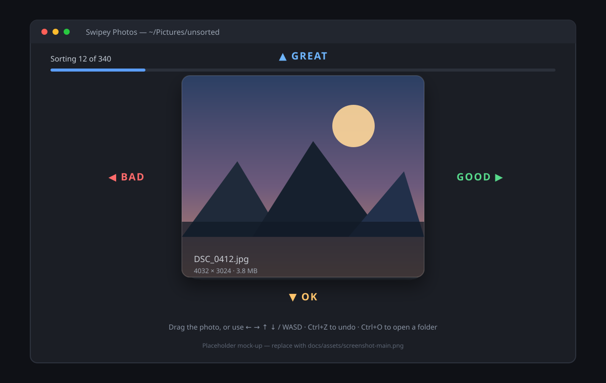

# Swipey Photos

> Sort a folder of photos by feel, not by filename.

**Swipey Photos** is a Linux desktop application for culling and sorting image
folders with Tinder-style swipe gestures. Point it at a folder, swipe each
picture left, right, up or down, and Swipey Photos moves it into the matching
subfolder. No tagging dialogs, no multi-select gymnastics — one decisive
gesture per photo.

[](https://github.com/torreyn/swipey-photos/actions/workflows/ci.yml)
[](https://github.com/torreyn/swipey-photos/releases/latest)
[](https://www.python.org/)
[](https://www.qt.io/)
[](LICENSE)
[](CHANGELOG.md)
[](#project-status)

> **Name.** The app is **Swipey Photos**, and the package (`swipey_photos`), the
> command (`swipey-photos`), the desktop entry and the config folder all follow
> it. It was called *ImageSwiper* during development and renamed before the first
> release, so nothing has to be migrated — see
> [docs/ARCHITECTURE.md](docs/ARCHITECTURE.md#13-naming) for the identifier rules
> and the checklist a future rename would follow.

---

## Screenshots



*Placeholder mock-up, not a capture of the real window.* Replacing it is a
five-minute job: [`screenshots/README.md`](screenshots/README.md) has a
copy-paste script that renders the window with `QT_QPA_PLATFORM=offscreen` and
`QWidget.grab()`, so no display, window manager or screenshot tool is needed.
The planned files are:

| File | Shows |
| --- | --- |
| `screenshots/main-window.png` | stage header, card, caption, arrow-labelled footer, summary bar |
| `screenshots/drag-feedback.png` | card mid-drag: rotation, tint and direction badge |
| `screenshots/summary.png` | completion page with the per-category tally |
| `screenshots/welcome.png` | welcome page with the recent-folder list |

Only images a document references belong in that folder — read
[`screenshots/README.md`](screenshots/README.md) for the window size, the naming
convention and why personal photos must stay out of the repository.

---

## Project status

`v1.0.0` is the **first packaged release**: the core loop, the comfort pass and
the desktop integration all ship together. The Qt-free business layer is
implemented and tested — image loading with EXIF handling, the four-way sorter
with undo, the folder manager, collision-safe file operations, JSON
configuration and rotating logs. The Qt side is wired up too: the swipe card
(drag physics, rotation, directional feedback, drop shadow, fly-out), the stage
around it, the welcome screen with recent folders, the completion summary and the
main window (menus, progress, arrow-labelled footer buttons, live status-bar
counts, config persistence). Install it with `pipx install
git+https://github.com/torreyn/swipey-photos.git`, download the standalone binary
from the [latest release](https://github.com/torreyn/swipey-photos/releases/latest),
or work from a checkout with `pip install .`; then run `swipey-photos` or
`python -m swipey_photos` and sort a folder end to end (400 tests, green on Python
3.11–3.13 in CI, ~94 % statement coverage). `packaging/` adds the `.desktop`
entry, the generated icon theme and an AppImage build script, and
`scripts/build.sh` produces the one-file binary — see
[`docs/PACKAGING.md`](docs/PACKAGING.md). Release history lives in
[`CHANGELOG.md`](CHANGELOG.md).

---

## Features

Everything below ships in v1.0 unless marked otherwise:

- **Four-way swipe sorting.** Each gesture maps to one destination folder:

  | Gesture | Keyboard | Destination (default) | Meaning |
  | --- | --- | --- | --- |
  | Swipe **right** → | <kbd>→</kbd> / <kbd>D</kbd> | `Good/` | Keep, usable |
  | Swipe **left** ← | <kbd>←</kbd> / <kbd>A</kbd> | `Bad/` | Reject |
  | Swipe **up** ↑ | <kbd>↑</kbd> / <kbd>W</kbd> | `Great/` | Best-of-set / portfolio |
  | Swipe **down** ↓ | <kbd>↓</kbd> / <kbd>S</kbd> | `OK/` | Neutral / undecided |

- **Non-destructive by design.** Images are *moved* into target subfolders —
  never deleted, never rewritten. Name collisions are resolved by suffixing,
  never by overwriting, and a cross-device destination is copied-then-verified
  before the source disappears.
- **Undo.** <kbd>Ctrl</kbd>+<kbd>Z</kbd> moves the last image back where it
  came from, up to a configurable history depth.
- **Keyboard-first alternative.** Arrows and WASD mirror every swipe, so the
  whole app is usable without a mouse or touchscreen.
- **Respects your pixels.** EXIF orientation is applied, huge images are
  downscaled for display only, and the originals are never re-encoded.
- **Snappy navigation.** Background decoding + prefetch of the next images so
  moving through a large folder stays responsive.
- **Remembers context.** Last folder, window size and theme are persisted to a
  human-editable JSON config; *View → Dark Mode* switches palettes live.
- **Looks the part.** Rounded card with a blurred drop shadow, a 150 ms fade-in
  for each new image, footer buttons that spell out their swipe (`← Bad`,
  `↓ OK`, `↑ Great`, `Good →`) and a live per-category summary bar at the bottom.
- **Safe to try.** `swipey-photos --dry-run FOLDER` logs what it *would* move and
  leaves every file untouched, so you can rehearse a sort first.
- **Fits your desktop.** `packaging/install-desktop.sh` adds a menu entry and a
  `hicolor` icon set (no desktop-file editing by hand), and
  `packaging/appimage/build-appimage.sh` bundles Python and PyQt6 into a single
  AppImage for machines without either. Details in
  [`docs/PACKAGING.md`](docs/PACKAGING.md).
- **Predictable buckets.** `Good/`, `Bad/`, `Great/` and `OK/` are created inside
  the folder you open, and a file is never overwritten — collisions gain a
  `_1`, `_2` suffix instead.
- **Safe failure modes.** Unreadable or corrupt images are skipped with a
  status-bar warning, animated GIFs show their first frame, huge images are
  downscaled for display while the original moves untouched, and permission
  errors are reported with the operating system's own message.

### Non-goals (v1.x)

- Cloud sync, AI/ML auto-tagging, RAW development, or editing pixels.
- Database-backed libraries. Swipey Photos operates directly on your folder.
- Windows/macOS builds. The code stays portable, but Linux is the target.

---

## Requirements

| Requirement | Version / notes |
| --- | --- |
| Linux | X11 or Wayland (tested on Debian/Ubuntu, Fedora, Arch) |
| Python | **3.11+** (uses `ExceptionGroup`, modern typing, `slots` dataclasses) |
| Qt | Qt 6.6+ via **PyQt6** (installed from PyPI, not from `apt`) |
| Pillow | 10+ — image validation, EXIF orientation, thumbnails |
| RAM | ~300 MB comfortable for a 5 000-image folder |

### PyQt6 vs. PySide6

The project targets **PyQt6**, as specified in the packaging metadata. Both
bindings expose the same Qt 6 API surface for everything this app needs
(`QWidget`, `QPropertyAnimation`, `QThreadPool`, `QGraphicsView`).

One caveat worth knowing up front: PyQt6 is **GPL v3 / commercial**, while
PySide6 is **LGPL v3**. If you ever plan to ship Swipey Photos as a closed-source
binary, either buy a Riverbank licence or switch the binding. Because all Qt
imports live in `swipey_photos/ui/` (and `app.py`), the switch is confined to
the UI layer — see [docs/ARCHITECTURE.md](docs/ARCHITECTURE.md#2-toolkit-decision).

---

## Installation

### 1. System packages (Qt runtime + Python tooling)

PyQt6 wheels bundle Qt itself, but Qt still needs a handful of system
libraries (notably the XCB platform plugin pieces on X11).

**Debian / Ubuntu / Linux Mint**

```bash
sudo apt update
sudo apt install -y python3 python3-venv python3-pip \
    libgl1 libegl1 libxkbcommon-x11-0 libdbus-1-3 \
    libxcb-cursor0 libxcb-icccm4 libxcb-keysyms1 libxcb-shape0 \
    libxcb-xinerama0 libxcb-randr0 libxcb-render-util0 libxcb-xfixes0
```

**Fedora**

```bash
sudo dnf install -y python3 python3-pip python3-virtualenv \
    mesa-libGL libxkbcommon-x11 xcb-util-cursor xcb-util-wm \
    xcb-util-keysyms xcb-util-renderutil dbus-libs
```

**Arch / Manjaro**

```bash
sudo pacman -S --needed python python-pip python-virtualenv \
    mesa libxkbcommon-x11 xcb-util-cursor xcb-util-wm \
    xcb-util-keysyms xcb-util-renderutil dbus
```

> Missing `libxcb-cursor0` is the single most common cause of
> `qt.qpa.plugin: Could not load the Qt platform plugin "xcb"`.

### 2. Install Swipey Photos

Swipey Photos is not on PyPI yet. Pick one of three routes.

**pipx — isolated, puts `swipey-photos` on your `PATH`**

```bash
pipx install git+https://github.com/torreyn/swipey-photos.git
swipey-photos --version  # Swipey Photos 1.0.0
```

Updating means re-running the same command with `--force`:

```bash
pipx install --force git+https://github.com/torreyn/swipey-photos.git          # newest tag
pipx install --force git+https://github.com/torreyn/swipey-photos.git@main     # bleeding edge
```

**From a checkout — for development**

```bash
git clone https://github.com/torreyn/swipey-photos.git
cd swipey-photos

python3 -m venv .venv
source .venv/bin/activate          # fish: source .venv/bin/activate.fish
python -m pip install --upgrade pip
pip install -e ".[dev]"            # contributing; `pip install -e .` for runtime only
```

Runtime-only install from the checkout, without the dev tooling:

```bash
pip install -r requirements.txt
pip install -e .            # optional: gives you the `swipey-photos` command
```

**Standalone binary — no Python required**

Download `swipey-photos-<version>-linux-x86_64` from the
[latest release](https://github.com/torreyn/swipey-photos/releases/latest):

```bash
chmod +x swipey-photos-1.0.0-linux-x86_64
./swipey-photos-1.0.0-linux-x86_64 --version
./swipey-photos-1.0.0-linux-x86_64 ~/Pictures/unsorted
```

The file carries CPython, PyQt6 and Pillow in one executable, but not glibc and
not the X11 client libraries, so the *system packages* from step 1 are still
required. To build it yourself:

```bash
./scripts/build.sh                 # venv + PyInstaller -> dist/swipey-photos
./scripts/build.sh --help          # --venv, --output, --clean, PIP_ARGS
```

`scripts/build.sh` and the release workflow share
[`swipey-photos.spec`](swipey-photos.spec), so a local build and the published
asset cannot drift apart. For a bundle that also contains the Qt system
libraries, use the AppImage script instead
([`docs/PACKAGING.md` §4](docs/PACKAGING.md#4-appimage)).

### 3. Verify the installation

```bash
python -c "import swipey_photos; print(swipey_photos.__version__)"
swipey-photos --version      # prints "Swipey Photos 1.0.0"
```

### 4. Add it to your application menu

```bash
./packaging/install-desktop.sh                      # this user (~/.local/share)
sudo ./packaging/install-desktop.sh --prefix /usr   # every user
```

The entry appears as **Swipey Photos → Photo Sorter** with its own icon.
`--uninstall` removes it again; `--destdir` stages a distribution package.
Paths, icon regeneration and the AppImage build live in
[`docs/PACKAGING.md`](docs/PACKAGING.md).

> A menu launcher does not inherit an activated virtualenv: it runs
> `swipey-photos` from `PATH`. If you installed into `.venv`, either point the
> install step at a user prefix (`pipx install .` or `pip install --user .`) or
> edit `Exec=` in the installed `.desktop` file to the absolute path of the
> script.

> **No Python on the target machine?** Download the standalone binary from the
> [latest release](https://github.com/torreyn/swipey-photos/releases/latest), or
> build one with `./scripts/build.sh`. If you also want the Qt system libraries
> inside the bundle, `packaging/appimage/build-appimage.sh` produces a
> single-file AppImage. Flatpak is not shipped yet;
> [`docs/PACKAGING.md`](docs/PACKAGING.md#5-flatpak) explains what a manifest
> would need.

---

## Usage

1. **Launch** the app:

   ```bash
   swipey-photos                      # reopens the last folder, or the picker
   swipey-photos ~/Pictures/unsorted  # skip the picker
   swipey-photos --dry-run ~/Pictures/unsorted  # rehearse: files are never moved
   ```

   `--dry-run` logs `dry run: would move …` for every decision, updates the
   counters and undo history exactly as usual, and marks the window title with
   `(dry run)` — the safe way to try the app on a folder you are not ready to
   sort. `--config PATH` reads and writes an alternative settings file and
   `-v` echoes the log to stderr.

2. **Pick a folder.** On a first run Swipey Photos shows a welcome page with a big
   *Select Folder* button and the five folders you opened last. It scans the
   chosen folder for supported image files (`.jpg`, `.jpeg`, `.png`, `.webp`,
   `.bmp`, `.gif`, `.tif`, `.tiff`).
3. **Swipe.** Drag the photo with the mouse, flick it with a touchscreen, or
   press an arrow/WASD key. Release past roughly a third of the window width
   (or press a key) to commit; release earlier and the card springs back. The
   four footer buttons carry the same map for anyone who prefers clicking:
   *← Bad*, *↓ OK*, *↑ Great* and *Good →*.
4. **Watch it move.** The file is moved into `Good/`, `Bad/`, `Great/` or `OK/`
   inside the folder you opened. The next image appears and the header counts
   `Image 3 of 47`.
5. **Undo** with <kbd>Ctrl</kbd>+<kbd>Z</kbd> if you misflicked.
6. **Finish.** When the folder is drained, a summary shows how many images went
   where, and offers to rescan the folder, pick another one, or quit.

Swipey Photos **never deletes or overwrites** anything. Subfolders it creates look
like this:

```text
~/Pictures/unsorted/
├── Bad/
├── Good/
├── Great/
├── OK/
├── DSC_0001.jpg          ← still to sort
└── DSC_0002.jpg
```

Already-sorted subfolders (and any folder listed as a destination) are skipped
during the scan, so re-running the app on the same parent folder will not
recycle files.

### Keyboard shortcuts

Every swipe has a keyboard equivalent, so the app works on a laptop keyboard,
a remote session, or for users who cannot use a pointing device.

| Action | Keys | Notes |
| --- | --- | --- |
| **Good** (swipe right) | <kbd>→</kbd> or <kbd>D</kbd> | moves to `Good/` |
| **Bad** (swipe left) | <kbd>←</kbd> or <kbd>A</kbd> | moves to `Bad/` |
| **Great** (swipe up) | <kbd>↑</kbd> or <kbd>W</kbd> | moves to `Great/` |
| **OK** (swipe down) | <kbd>↓</kbd> or <kbd>S</kbd> | moves to `OK/` |
| Undo last move | <kbd>Ctrl</kbd>+<kbd>Z</kbd> | restores the previous file |
| Skip for now | <kbd>Space</kbd> | leaves the file in place, shows it again later |
| Open folder… | <kbd>Ctrl</kbd>+<kbd>O</kbd> | choose another source folder |
| Rescan folder | <kbd>F5</kbd> or <kbd>Ctrl</kbd>+<kbd>R</kbd> | picks up newly added files |
| Toggle fullscreen | <kbd>F11</kbd> | distraction-free culling |
| Shortcut help | <kbd>F1</kbd> or <kbd>?</kbd> | overlay with this table |
| Quit | <kbd>Ctrl</kbd>+<kbd>Q</kbd> | window state is saved |

WASD keys are ignored while a text field (e.g. a folder-path input) has focus.
Arrow keys always work.

---

## Configuration

Swipey Photos is configured with a single human-editable JSON file:

```text
${XDG_CONFIG_HOME:-~/.config}/swipey-photos/config.json
```

The file is written on first save (when the window closes). A minimal example:

```json
{
  "last_folder": "/home/you/Pictures/to-sort",
  "recent_folders": [
    "/home/you/Pictures/to-sort",
    "/home/you/Pictures/2024-06-trip"
  ],
  "theme": "system",
  "version": 1,
  "window": { "height": 800, "width": 1200 }
}
```

`theme` is `system`, `light` or `dark`; *View → Dark Mode* writes the value when
the user toggles it, and `system` follows the desktop's colour scheme.
`last_folder` is reopened at start-up and may be `null`. `recent_folders` holds at
most five folders, newest first, and feeds the welcome page's shortcut list.
Unknown keys are ignored with a warning, so a file from a newer build still
loads. The file is replaced atomically with mode `0600`.

Logs are written to
`${XDG_DATA_HOME:-~/.local/share}/swipey-photos/logs/swipey-photos.log`, rotated at
2 MiB with three backups.

Full key-by-key reference, precedence rules and migration notes:
**[docs/CONFIGURATION.md](docs/CONFIGURATION.md)**.

---

## Project structure

```text
swipey-photos/
├── src/swipey_photos/         # importable package (src layout)
│   ├── __init__.py            # version + public package docstring
│   ├── __main__.py            # `python -m swipey_photos` / `swipey-photos` entry point
│   ├── app.py                 # QApplication bootstrap, wiring, lifecycle
│   ├── py.typed               # PEP 561 marker (type info ships with the wheel)
│   ├── ui/                    # Qt-only layer (all PyQt6 imports live here)
│   │   ├── main_window.py     # shell: menus, status bar, three-page session wiring
│   │   ├── welcome_screen.py  # "Select Folder" empty state + recent folders
│   │   ├── completion_screen.py # per-category summary, restart/pick/quit
│   │   ├── swipe_card.py      # one image: drag, rotation, badge, fly-out (gui)
│   │   ├── swipe_widget.py    # stage: hosts the card, feeds images, forwards swipes
│   │   ├── animator.py        # card entrance fade/slide, timing, easing
│   │   ├── workers.py         # thread-pool preview prefetch + cache
│   │   ├── image_utils.py     # Pillow → QImage/QPixmap conversion
│   │   ├── theme.py           # light/dark palettes, system preference
│   │   ├── shortcut_overlay.py # F1/? keyboard reference grid
│   │   └── branding.py        # generated window icon and welcome logo
│   ├── core/                  # toolkit-agnostic logic (no Qt imports)
│   │   ├── image_loader.py    # folder scanning, validation, decode, prefetch
│   │   ├── sorter.py          # queue cursor, category moves, undo stack
│   │   └── folder_manager.py  # category folders, validation, collision-free moves
│   └── utils/                 # reusable helpers, no UI/core knowledge
│       ├── file_ops.py        # collision-safe moves, reverse moves, path helpers
│       ├── config.py          # JSON defaults/load/save, XDG paths, recent folders
│       └── logging_setup.py   # rotating file logs + optional console handler
├── tests/                     # pytest suites mirroring src/ (pytest-qt for GUI)
├── scripts/
│   └── build.sh               # venv + PyInstaller -> dist/swipey-photos
├── swipey-photos.spec         # PyInstaller recipe shared by build.sh and CI
├── screenshots/               # capture guide + reference images (placeholders)
├── packaging/                 # desktop integration, no Python imports needed
│   ├── swipey-photos.desktop  # menu entry: Exec=swipey-photos, Icon=swipey-photos
│   ├── install-desktop.sh     # install/uninstall entry + icons (prefix/destdir)
│   ├── icons/hicolor/         # generated PNG sizes + one scalable SVG
│   ├── render_icons.py        # regenerate the icon tree from ui/branding.py
│   ├── appimage/build-appimage.sh  # bundle CPython + PyQt6 into one AppImage
│   └── pyinstaller/entry.py   # launcher the one-file binary starts from
├── docs/
│   ├── README.md              # documentation index and reading order
│   ├── ARCHITECTURE.md        # layers, contracts, data flow, state machines
│   ├── CONFIGURATION.md       # every option, defaults, precedence
│   ├── DEVELOPMENT.md         # setup, commands, conventions, test strategy
│   ├── PACKAGING.md           # desktop entry, icons, AppImage, distro notes
│   └── assets/                # placeholder mock-ups
├── .github/
│   ├── workflows/ci.yml       # lint, format, types, tests + coverage, xvfb GUI run
│   ├── workflows/release.yml  # tag -> binary + wheel + sdist on the Release
│   └── ISSUE_TEMPLATE/        # bug report and feature request forms
├── pyproject.toml             # metadata, deps, tool config, entry point
├── requirements.txt           # runtime pins for plain pip workflows
├── README.md
├── CONTRIBUTING.md            # code style, layer rules, PR checklist
├── CHANGELOG.md               # Keep a Changelog, newest first
├── SECURITY.md                # private reporting, in-scope filesystem bugs
├── LICENSE                    # MIT
└── .gitignore                 # Python + PyQt + VSCode + Linux noise
```

Dependency direction is strictly one-way — `utils` ← `core` ← `ui` ← `app` —
and is enforced by review plus `tests/test_architecture.py`, which parses the
imports with `ast` and fails on any Qt import below `ui/`. Details and rationale:
**[docs/ARCHITECTURE.md](docs/ARCHITECTURE.md)**.

---

## Roadmap

| Milestone | Scope | Status |
| --- | --- | --- |
| **M0 — Scaffolding** | Layout, packaging, docs, module contracts, CI pipeline | ✅ done |
| **M1 — Image pipeline** | `image_loader`, EXIF handling, prefetching, fixture tests | ✅ done |
| **M2 — Swipe UI** | `swipe_card` (card, drag, badge, fly-out), `swipe_widget` stage, main window, welcome/summary pages, deck fly-in (`animator`) | ✅ done |
| **M3 — Sorting** | `folder_manager`, `sorter`, `file_ops`, collision handling | ✅ done |
| **M4 — Comfort** | Undo, config UI + dark mode, summary screen, logging, error reporting, rescan/full-screen/shortcut keys, shortcut overlay, prefetch workers, `--dry-run`, edge-case messaging | ✅ done |
| **M5 — Distribution** | `.desktop` file, icons, AppImage/Flatpak, 1.0 | ✅ done (v1.0.0; Flatpak deferred, see [PACKAGING §5](docs/PACKAGING.md#5-flatpak)) |

---

## Development quickstart

```bash
python3 -m venv .venv
source .venv/bin/activate
pip install -e ".[dev]"

python -m swipey_photos            # run from source
pytest -q                         # unit tests
QT_QPA_PLATFORM=offscreen pytest -q -m gui   # headless GUI tests
pytest -q --cov=swipey_photos --cov-report=term-missing   # coverage
ruff check . && ruff format --check .
mypy
./scripts/build.sh                # standalone binary -> dist/swipey-photos
```

CI runs `ruff check`, `ruff format --check`, strict `mypy`, the full suite with
coverage on Python 3.11, 3.12 and 3.13, the GUI tests again under `xvfb-run`
(so the real `xcb` plugin is exercised), and a packaging job that builds the
wheel/sdist and installs the wheel into a clean environment — see
[`.github/workflows/ci.yml`](.github/workflows/ci.yml).

Conventions, fixtures and the definition of done for a PR are in
**[docs/DEVELOPMENT.md](docs/DEVELOPMENT.md)**; the release procedure is in
**[docs/PACKAGING.md §7](docs/PACKAGING.md#7-checklist-before-tagging-a-release)**.

---

## Contributing

Contributions are welcome — bug reports, UX feedback, translations, and code.
Please read **[CONTRIBUTING.md](CONTRIBUTING.md)** before opening a pull
request. In short:

1. Search existing issues, then open one describing the change.
2. Fork, branch from `main` (`feat/…`, `fix/…`, `docs/…`).
3. Keep the layer boundaries: no Qt imports in `core/` or `utils/`.
4. Add or update tests; `pytest`, `ruff check .` and `mypy` must pass.
5. Add an `[Unreleased]` entry to [CHANGELOG.md](CHANGELOG.md) for anything a
   user can notice.
6. Use [Conventional Commits](https://www.conventionalcommits.org/) style.
7. Open the PR and reference the issue — the
   [checklist](CONTRIBUTING.md#pull-request-checklist) mirrors CI.

Found a filesystem or data-loss bug? Report it privately via
[SECURITY.md](SECURITY.md) instead of a public issue.

This project follows the
[Contributor Covenant, v2.1](https://www.contributor-covenant.org/version/2/1/code_of_conduct/).

---

## FAQ

**Where do my images go?**
Into `Good/`, `Bad/`, `Great/` and `OK/` subfolders of **the folder you selected**
— nothing leaves your library, and the same folder can be re-opened later to
continue sorting. Images are *moved*, not rewritten: the original file, its
EXIF data and its quality are untouched, and a name collision gains a `_1`, `_2`
suffix instead of overwriting anything. When a destination lives on another
filesystem, the app copies the file, verifies the byte count and only then
removes the source, because a rename cannot cross devices. Nothing is ever
deleted — `Bad/` is just a folder, and emptying it is your decision. Rehearse the
whole thing with `swipey-photos --dry-run FOLDER`, which logs what would move and
touches no file.

**Does it delete rejected photos?**
No. Rejected images are moved to `Bad/` (or your configured folder). Nothing is
ever deleted by Swipey Photos.

**Will it touch files already in `Good/`?**
No. Destination folders are excluded from the scan, so only not-yet-sorted
images in the selected folder are shown.

**Does it work on Wayland?**
Yes. Gestures are handled inside the app window, so no compositor-level gesture
permissions are needed.

**Can I use a touchscreen or touchpad?**
Touchscreens send synthetic mouse events, which the card already supports.
Two-finger touchpad "flick" gestures depend on the compositor; the keyboard
bindings are the reliable fallback.

**How can I support the project?**
*Help → About* carries a **Buy me a coffee** button that opens
<https://buymeacoffee.com/2re.me>. Bug reports and a star on the repository help
just as much.

---

## License

Released under the [MIT License](LICENSE) — © 2026 Swipey Photos contributors.

Qt is © The Qt Company and is used through PyQt6 (GPL v3 / commercial) or
PySide6 (LGPL v3); see [Requirements](#pyqt6-vs-pyside6). Pillow is licensed
under the HPND licence.
