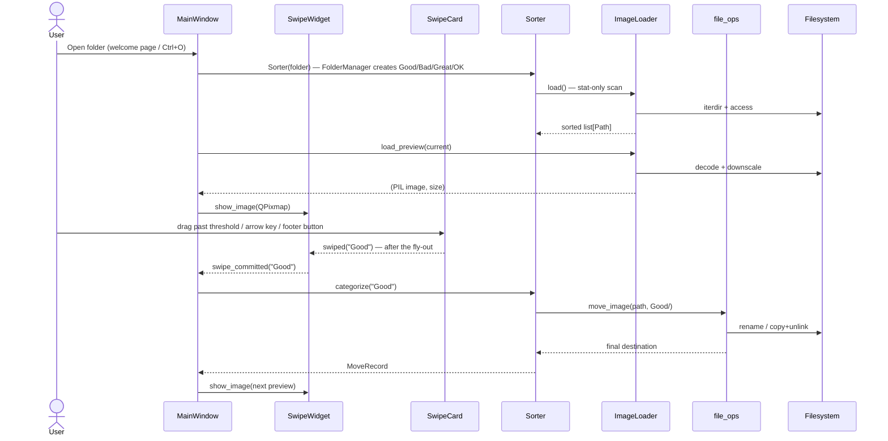

# Architecture

> Status: **implemented.** `core/`, `utils/` and the UI layer described below
> exist and are covered by the test suite; the only parts still marked as
> planned are the deck fly-in animator (`ui/animator.py`) and the background
> worker adapters (`ui/workers.py`). This document is the contract the
> implementation satisfies.

## 1. Purpose and scope

ImageSwiper does one job: present the images of a folder one at a time, capture
a four-way decision per image, and move the file into the matching subfolder
without ever destroying data. Everything in this document serves that loop.

In scope for v1.0:

- Folder selection and scanning, including corrupt-file handling.
- Display of a single image with drag/keyboard decisions and feedback.
- Collision-safe moves and a bounded undo history.
- Local, human-editable configuration and file logging.

Explicitly out of scope: editing, RAW development, cloud sync, ML tagging,
multi-window sessions, databases, and non-Linux packaging.

### Constraints

| Constraint | Consequence for the design |
| --- | --- |
| Python 3.11+ | `ExceptionGroup`, modern typing, `slots` dataclasses, `getLevelNamesMapping` |
| PyQt6 / Qt 6.6+ | All UI code depends on Qt; core must not, so it stays testable and CLI-reusable |
| GTK/GNOME and KDE | Use Qt's own file dialog; respect the system theme; no compositor-specific APIs |
| X11 **and** Wayland | Gestures are handled inside the window (mouse/touch events), not compositor-wide |
| User photos are irreplaceable | No overwrite, no implicit delete, no re-encode, undo required |
| Large folders | Never block the GUI thread; stream and prefetch, bounded memory |

## 2. Toolkit decision

The project uses **PyQt6** (GPL v3 / commercial). It is mature, well typed, and
ships Qt 6 wheels on PyPI.

The alternative, **PySide6**, is Qt's official binding under **LGPL v3**. If
ImageSwiper is ever distributed as a closed-source binary — or linked
statically — PySide6 is the legally simpler choice (dynamic linking under LGPL
still carries relinking obligations).

Mitigation for the licence risk: **every Qt import lives in `image_swiper/ui/`
and `app.py`.** `core/` and `utils/` are pure Python. Switching bindings is
therefore a mechanical change of imports (`PyQt6` → `PySide6`, `pyqtSignal` →
`Signal`) without touching the domain logic. A `qtpy` compatibility shim is
possible but deliberately avoided: the indirection costs more than it saves for
a single-app codebase.

Widget choices are deliberately plain: `QWidget` + `QPainter` for the card
(no `QGraphicsScene` needed for one card), `QPropertyAnimation` for movement,
`QThreadPool`/`QRunnable` for I/O, and JSON instead of `QSettings` so the
configuration file stays human-editable and greppable.

## 3. Design principles

1. **One-way dependencies.** `app → ui → core → utils`. A lower layer never
   imports an upper one. `tests/test_architecture.py` enforces the Qt-free rule.
2. **The UI is a dumb terminal.** Widgets render state and emit intent; they do
   not decide *where* files go or *how* names collide.
3. **Core is synchronous and explicit.** No hidden threads, no Qt signals, no
   globals. Callers choose the execution context; this is what makes `core`
   unit-testable with `tmp_path`.
4. **Composition root only in `app.py`.** Concrete objects are instantiated in
   exactly one place and injected downwards (constructor arguments), so tests
   can substitute fakes without monkey-patching.
5. **Data safety over cleverness.** Every filesystem mutation goes through
   `utils/file_ops.py`; every move is reversible or refused.
6. **Fail soft, never silently.** The session survives an unreadable image, a
   deleted folder or a permission error; the user is told what happened.
7. **Explicit state machines.** Swipe and session transitions are enumerated
   (§5.2, §8), so input during animations and undo during moves are defined
   behaviour rather than race conditions.

## 4. System overview

```text
┌──────────────────────────────────────────────────────────────────────┐
│ __main__.py — argv parsing, logging, exit code                       │
└───────────────────────────────┬──────────────────────────────────────┘
                                │ run(argv)
┌───────────────────────────────▼──────────────────────────────────────┐
│ app.py — QApplication, config, dependency wiring (composition root)  │
└───────────────────────────────┬──────────────────────────────────────┘
                                │ constructs
┌───────────────────────────────▼──────────────────────────────────────┐
│ ui/  (Qt)                                                            │
│   MainWindow ── SwipeWidget ── CardAnimator                          │
│        │              │                                              │
│        └──── signals ─┴── workers.py (QRunnable ↔ QThreadPool)       │
└───────────────────────────────┬──────────────────────────────────────┘
                                │ calls (plain Python, no Qt types)
┌───────────────────────────────▼──────────────────────────────────────┐
│ core/  (no Qt)                                                       │
│   FolderManager ── ImageLoader ── Sorter                             │
└───────────────────────────────┬──────────────────────────────────────┘
                                │
┌───────────────────────────────▼──────────────────────────────────────┐
│ utils/  (no Qt, no domain knowledge)                                 │
│   file_ops.py        config.py        logging_setup.py               │
└──────────────────────────────────────────────────────────────────────┘
```

| Module | Layer | Owns | Must never |
| --- | --- | --- | --- |
| `__main__.py` | entry | argv, logging bootstrap, exit code | construct widgets |
| `app.py` | composition | `QApplication`, dependency graph, lifecycle | contain business rules |
| `ui/main_window.py` | UI | layout, actions/shortcuts, session presentation | read/decode files |
| `ui/shortcut_overlay.py` | UI | shortcut reference grid, key-cap styling | read session state or files |
| `ui/swipe_card.py` | UI | one image: fit, drag maths, badge, fly-out, keys | know about folders, files or categories on disk |
| `ui/swipe_widget.py` | UI | stage geometry, image hand-off, signal forwarding | touch the filesystem |
| `ui/animator.py` | UI | fly-in/stage fades, shared timing and easing | know about `Path` or config files |
| `ui/workers.py` | UI↔core | thread-pool adapters, signal marshalling | mutate widgets |
| `core/folder_manager.py` | core | category folders, category validation, collision-free moves | know about Qt |
| `core/image_loader.py` | core | scanning, validation, preview decode, EXIF | import Qt |
| `core/sorter.py` | core | queue cursor, category moves, undo stack | show dialogs or import Qt |
| `utils/file_ops.py` | utils | collision-safe move/copy/reverse | know about images |
| `utils/config.py` | utils | schema, defaults, JSON I/O, XDG paths | scan folders |
| `utils/logging_setup.py` | utils | handlers, formatting, log paths | import Qt or own app state |

### Object graph (runtime)

```text
ImageSwiperApplication (app.py)
├── Config                      (utils/config.py, loaded once)
├── Sorter                      (core/sorter.py, one per session)
│   └── FolderManager           (core/folder_manager.py)
├── ImageLoader                 (core/image_loader.py)
├── QThreadPool                 (preview + scan jobs)
└── MainWindow                  (ui/main_window.py)
    ├── SwipeWidget             (ui/swipe_widget.py)  — the stage
    │   └── SwipeCard           (ui/swipe_card.py)    — one image
    ├── CardAnimator            (ui/animator.py)
    └── QStatusBar / actions / menus
```

`app.py` wires these, then hands the window a *session façade* (loader + sorter
+ config). `MainWindow` never builds a `Sorter` itself.

## 5. Component contracts

### 5.1 App shell

`__main__.py` parses arguments (optional folder, `--version`, `--config`,
`--log-level`, `--verbose`), calls `setup_logging()`, answers `--version`
without importing Qt, and delegates to `app.run()`.

`app.py` is the composition root. `run()` sets the high-DPI rounding policy
*before* constructing exactly one `QApplication`, sets `applicationName=
"image-swiper"`, `applicationDisplayName="ImageSwiper"`, `organizationName`,
the version, the desktop file name and the window icon, installs the Qt message
handler, loads config, calls `build_main_window()`, shows the window, opens the
requested folder (or `MainWindow.restore_last_session()`), and returns
`app.exec()`. `build_main_window(app, config, config_path=...)` is the seam
integration tests use to get the wired window without running a loop.

Startup order matters: logging before config (config errors must be logged),
config before widgets (geometry), Qt handler after `QApplication` exists (it
needs Qt types to map message levels).

Shutdown: `aboutToQuit` and `MainWindow.closeEvent` both call `save_state()`,
which writes window size, `last_folder` and `recent_folders`. Saving is
best-effort: a read-only config directory produces a status-bar message, never a
crash. Once `ui/workers.py` lands, shutdown will also wait on the thread pool
with a short timeout; today preview decoding is synchronous on the GUI thread.

### 5.2 UI layer

**`MainWindow`** is the presenter and the only class that holds session state:
the active `Sorter`, three pages in a `QStackedWidget` (welcome, stage,
completion), the progress counters and a `_busy` flag. It performs no I/O
itself. Its slots translate UI intent into core calls:

| Signal (from) | Handling in `MainWindow` |
| --- | --- |
| `WelcomeScreen.folder_selected(str)` | `open_folder()`: build the sorter, remember the folder, show the first preview |
| `SwipeWidget.swipe_committed(str)` | guard `_busy`; `Sorter.categorize()`; report or skip on failure; load the next preview or show the summary |
| category `QAction` (arrows/WASD) or footer button | `SwipeWidget.trigger_swipe(category)`, so keyboard, click and drag share the card's fly-out |
| `File → Rescan Folder` (F5, Ctrl+R) | `Sorter.reload()`, which re-reads the folder and keeps the counters and undo history; empty means the summary |
| `View → Full Screen` (F11) | `showFullScreen()`/`showNormal()`, with the menu tick resynchronised in `changeEvent` |
| `Help → Keyboard Shortcuts` (F1, ?) | `ShortcutOverlay.show_overlay()`, one reused non-modal dialog |
| `File → Undo Last` (Ctrl+Z) | `Sorter.undo()`, re-show the restored image, return to the stage |
| skip `QAction` (Space) | `Sorter.advance()`; the file stays in the folder |
| `CompletionScreen.open_source_requested` | rescan the same folder |
| `CompletionScreen.pick_folder_requested` | `QFileDialog` → `open_folder()` |
| `CompletionScreen.quit_requested`, File → Quit | `close()`, which saves state |

Preconditions are enforced in the window: `_can_decide()` is false while a move
is in flight, on the welcome/summary pages, or when the deck is empty, and the
actions and footer buttons are disabled accordingly. Rescan is enabled whenever a
session exists and no move is in flight. A second decision during the ~250 ms
fly-out is dropped by the card itself, so the same file can never be moved twice.

Every failure is logged and routed through `_report_info`, `_report_warning` or
`_report_error` — the only methods that open a `QMessageBox`, and therefore the
seam that offscreen tests replace.

Shortcut hygiene worth knowing: `QKeySequence.StandardKey.Quit` is **empty**
outside macOS, so File → Quit binds `Ctrl+Q` explicitly; the rest of the table
comes from `StandardKey.Open`/`Undo` plus literal sequences. `SHORTCUT_GROUPS` in
`ui/shortcut_overlay.py` is the documentation table, and
`tests/test_main_window.py` asserts that every bound `QAction` shortcut appears
in it, so a new binding cannot ship undocumented.

**`SwipeWidget`** is the stage: a `CardStage` that assigns the card geometry in
`resizeEvent` (the card cannot live in a layout because it moves itself), plus a
caption line. It shows one pixmap at a time, re-arms the card with `set_pixmap`,
forwards `SwipeCard.swiped` as `swipe_committed(str)` and gates commits with
`set_interactive(False)` while the window is busy. It owns no session state and
touches no files.

**`WelcomeScreen`** and **`CompletionScreen`** are pure views. The welcome page
reports a chosen folder and lists at most five recents; the summary renders the
per-category counts it is given and emits restart/pick/quit. Neither reads the
sorter or the configuration directly.

**`ShortcutOverlay`** is the F1/`?` reference page: a non-modal `QDialog` that
renders `SHORTCUT_GROUPS` — group headings, key caps and one-line descriptions —
from a single table. It owns no session state, so the window builds it lazily and
reuses that instance; `show_overlay()` raises an already-visible overlay instead
of stacking copies, and Close/Esc only hide it. Key caps and headings use palette
roles, so the overlay stays legible in light and dark themes without hard-coding
colours.

The diagram below is `SwipeCard`'s internal state machine (`ui/swipe_card.py`),
where pointer handling, thresholds, rotation and the badge live:

```text
             key press (window forwards)
                        │
                        ▼
   ┌────────┐  press  ┌──────────┐ release < threshold  ┌─────────────┐
   │  IDLE  │────────▶│ DRAGGING │─────────────────────▶│ SPRING_BACK │──┐
   └────────┘         └────┬─────┘                      └─────────────┘  │
        ▲                  │ release ≥ threshold                           │
        │                  ▼                                              │
        │            ┌───────────┐   card leaves the window              │
        └────────────│ COMMITTED │──────────────────────────────────────┘
                     └───────────┘        (owner loads the next image)
```

- Axis resolution: each axis offset is divided by its own threshold (25 % of the
  card width horizontally, 20 % of the height vertically), so the dominant
  gesture wins even though the pixel distances differ. Ties go to horizontal.
- Drag visuals: translation follows the pointer 1:1, rotation is proportional to
  horizontal travel and capped at 15°, badge opacity is
  `min(1.0, distance / threshold)`.
- On release below the threshold the card springs back and the badge fades out;
  no category is emitted.
- `SwipeWidget.set_interactive(False)` disables the card while a move is in
  flight, and `trigger_swipe()` is ignored mid-animation, so a held key cannot
  commit the same image twice. The window re-enables input when the next
  preview is ready.
- Keyboard input: the window owns window-wide `QAction`s (arrows and WASD) and
  forwards them to `SwipeWidget.trigger_swipe(category)`. The card maps the same
  keys itself so the standalone demo works without the window.

**`branding.py`** paints the window icon and the welcome logo at runtime (one
rounded tile, a card stack and two chevrons) so the project ships no binary
assets; `app.py` and `WelcomeScreen` share it.

**`CardAnimator`** (planned, milestone M4) encapsulates `QPropertyAnimation`
groups for the card's `pos`, a custom `rotation` `Q_PROPERTY` and
`windowOpacity`. It exposes `fly_out`, `fly_in`, `spring_back` and `stop`, emits
`finished(name)`, uses durations from config (clamped 60–600 ms), and degrades to
an instant state change when reduced motion is requested. Interrupting an
animation snaps the card to a defined endpoint first — no overlapping animation
groups. Today the card flies itself out and springs itself back; the stage simply
swaps the pixmap.

**`workers.py`** adapts synchronous core calls to the Qt thread pool. A worker
takes plain data, returns a frozen result object, emits `finished`/`failed`, and
never holds a widget reference. `QRunnable` + a `QObject` signals holder is used
instead of `QThread` subclasses: fewer objects, easier cleanup, and no
thread-affinity surprises.

### 5.3 Core layer

**`FolderManager`** answers "may we work here, and where do files go?". It
resolves the source folder (`~` expansion, `Path.resolve()`), refuses a missing
or non-directory root with `SourceFolderError`, creates the four category
folders (`Good`, `Bad`, `Great`, `OK`) on construction, and validates the
category a caller passes via `normalize_category` (case-insensitive, canonical
spelling stored). `move_image` delegates to `file_ops.move_file`, so collisions
are resolved centrally, and logs every attempt — INFO on success with the final
path, ERROR on failure. `category_folders` and `destination_for` expose the
layout, `is_inside` answers containment questions. Because `ImageLoader` scans
non-recursively, the category folders need no exclusion list.

**`ImageLoader`** owns format knowledge, EXIF handling and preview decoding:

| Concern | Decision |
| --- | --- |
| Supported formats | `.jpg .jpeg .png .webp .bmp .gif .tif .tiff` (case-insensitive) |
| Recursion | none — `iterdir()` only, so destination folders never re-queue |
| Hidden/unsupported files | skipped at DEBUG |
| Corrupt files | skipped at WARNING when `validate=True` (the default) |
| Unreadable files | skipped at WARNING, scan continues |
| Symlinks | files are followed, linked directories are not descended into |
| Ordering | case-insensitive natural sort (`IMG_2` before `IMG_10`) |
| Orientation | `ImageOps.exif_transpose` applied when decoding |
| Preview size | longest edge ≤ 1600 px by default, LANCZOS, RGB/RGBA |
| Return type | Pillow image + orientation-corrected size; **never** a Qt type |

`load()` caches its result so the window can ask repeatedly; `reload()` rescans
and is the only way to pick up files added mid-session. `validate_image` works
standalone and `next_candidates(index, lookahead)` supports prefetching.

**`Sorter`** is the session state machine and the only core component that
mutates the filesystem (through `FolderManager` → `file_ops`):

1. `current_image()` returns the image at the cursor, or `None` when finished.
2. `advance()` moves the cursor without touching the file, so a skipped image
   survives for a later session.
3. `categorize(category)` validates the category, asks the folder manager for a
   collision-free destination, pops the image from the queue, increments the
   per-category counter, records `MoveRecord(source, destination, category,
   index, moved_at)` in a bounded deque, then calls `on_record` if provided.
4. `undo()` pops the newest record and calls `file_ops.reverse_move`, which
   recreates a missing source folder and never overwrites a file that now
   occupies the original name; the restored image becomes current again.
5. Failures leave history and counters untouched. A file deleted behind the
   app's back raises `MissingImageError` after being dropped from the queue, so
   the caller can report it and continue.

No Qt import and no signals: the window subscribes through `on_record`, which
keeps the core headless and unit-testable.

### 5.4 Utils layer

**`file_ops`** is the narrow waist for all mutations. It guarantees:
no overwrite (`unique_path` → `photo_1.jpg`), typed exceptions carrying both
paths (`SourceNotFoundError`, `SameFileError`, `DestinationUnwritableError`,
`FileOperationError`), cross-device fallback (copy → size check → unlink) for
`EXDEV`, and reverse moves that recreate parent directories. It has no notion of
images or categories, so it can be tested exhaustively with `tmp_path`.

**`config`** defines the schema as frozen dataclasses (`Config`,
`WindowConfig`), reads and writes `config.json`, validates values with
actionable messages, and resolves XDG paths:

| Purpose | Path |
| --- | --- |
| Config | `${XDG_CONFIG_HOME:-~/.config}/image-swiper/config.json` |
| Logs | `${XDG_DATA_HOME:-~/.local/share}/image-swiper/logs/image-swiper.log` (2 MiB × 3 rotations) |

A missing file yields defaults. Malformed JSON raises `ConfigError` and invalid
values raise `ConfigValidationError`, so the UI can show a message and continue
with defaults instead of silently discarding the user's settings. Unknown keys
and a newer `version` only warn. `recent_folders` keeps at most five newest-first
paths and feeds the welcome page; `with_recent_folder()` promotes a folder and
drops duplicates. Writes are atomic (tempfile + `fsync` + `os.replace`), with
`0o600` for the file and `0o700` for the directory. A `version = 1` key reserves
room for migrations. Precedence: CLI > environment > file > defaults.

**`logging_setup`** configures one logger hierarchy (`image_swiper.*`) with a
rotating file handler plus an optional stderr handler, and exposes
`logs_dir()`/`get_logger()`. It imports no Qt: the Qt message bridge belongs to
the UI layer (M2). Levels follow CONTRIBUTING.md; there is no `print()` in
`src/`.

## 6. Data flow

### 6.1 End-to-end sequence

The core loop, from folder selection to the next image:

```text
1. User picks a folder (welcome page, Ctrl+O, or a CLI argument)
       ↓
2. MainWindow.open_folder() → default_sorter_factory(folder)
       ↓
3. FolderManager(folder) → Good/Bad/Great/OK created, layout validated
   ImageLoader(folder, validate=False).load() → sorted list[Path]  (stat only)
       ↓
4. Sorter owns the queue; progress comes from total/remaining_count
       ↓
5. ImageLoader.load_preview(path) → (PIL image, original size)
       ↓  MainWindow.qimage_from_pil() → QPixmap on the GUI thread
6. SwipeWidget.show_image(pixmap, caption=...) — card armed, interactive
       ↓
7. Gesture: mouse drag past threshold, OR arrow/WASD key, OR footer button
       ↓
8. SwipeCard flies itself out, then emits swiped(category)
       ↓
9. SwipeWidget forwards it as swipe_committed(category)
       ↓
10. MainWindow: Sorter.categorize(category) → FolderManager.move_image
       ↓  collision-free final path, MoveRecord appended to undo history
11. Counters, progress label, status bar and undo action refreshed
       ↓
12. Next preview decoded and shown → back to step 6
       ↓
13. Queue empty → CompletionScreen with per-category counts
```

The whole loop runs on the GUI thread today. The expensive part of opening a
folder is avoided by scanning with ``validate=False`` (stat + extension check
only); one preview is decoded per image, which is tens of milliseconds. Moving
steps 3 and 5 onto `ui/workers.py` is the planned optimisation and changes
nothing in the contracts above.

The whole loop runs on the GUI thread today. The expensive part of opening a
folder is avoided by scanning with `validate=False` (stat + extension check
only); one preview is decoded per image, which is tens of milliseconds. Moving
steps 3 and 5 onto `ui/workers.py` is the planned optimisation and changes
nothing in the contracts above.



### 6.2 Threading model

| Work | Where | Why |
| --- | --- | --- |
| Widgets, painting, animations | GUI thread | Qt requirement |
| Folder scan (stat + extension check) | GUI thread today; thread pool planned | ~50 ms for 5 000 files, acceptable inline |
| Preview decode (LANCZOS downscale) | GUI thread today; thread pool planned | CPU-bound, 10–80 ms per image |
| File move/copy | GUI thread today; **one** worker planned | serialises history and keeps undo ordering deterministic |
| Config read | GUI thread at startup | tiny file, once |
| Config write | GUI thread on folder change and close | avoid races with shutdown |

Rules that keep the current single-threaded loop safe — and that the worker
adapters must preserve when they land:

- A decision is only accepted when the window is on the stage page, not busy and
  the deck is not empty (`MainWindow._can_decide()`); the card additionally
  ignores `trigger_swipe()` while it is animating. Double moves are impossible
  even if two input sources fire at once.
- Workers receive immutable data and emit results through signals; they never
  touch a `QWidget`, `QPixmap` or the config object.
- Every scan/preview job will carry a monotonically increasing `generation`
  counter, so a result from a previous folder is dropped instead of showing a
  stale image.
- Preview queue depth will be capped (prefetch window = 2); stale requests are
  discarded so rapid swiping never floods the pool.
- Moves are serialised: `Sorter` appends history in call order, so a parallel
  caller must not interleave two `categorize()` calls.
- On shutdown, `QThreadPool.waitForDone(2000)` runs after hiding the window;
  remaining jobs are abandoned rather than blocking exit indefinitely.

## 7. Session state machine

`MainWindow` exposes exactly one session state at a time. Input is interpreted
against that state, which is what prevents double moves and lost undo entries.
The state is the visible page plus the `_busy` flag, so it is always
inspectable (`MainWindow.current_page` returns `"welcome"`, `"stage"` or
`"completion"`).

| State | Meaning | Accepts | Next |
| --- | --- | --- | --- |
| `EMPTY` (welcome page) | no folder chosen, or the last one is unusable | open folder, quit | `READY` |
| `READY` (stage, not busy) | image shown, waiting for input | swipe, key, footer button, skip, undo, open | `DECIDING` / `DONE` |
| `DECIDING` (stage, busy) | card animating out, move running | undo after completion, open | `READY` / `DONE` |
| `DONE` (completion page) | queue drained | undo, rescan, pick another folder, quit | `READY` |

Transitions are explicit methods (`open_folder`, `_on_swipe_committed`,
`_on_undo`, `_on_skip`, `_show_completion`), each guarding with `_busy` or
`_can_decide()` instead of asserting: a stray signal must never raise inside a
Qt callback. A failed move returns to `READY` with the image still queued and
re-rendered — the same file can be retried safely because nothing was mutated.

There is no separate `SCANNING` state today because the stat-only scan is fast
enough to run inline; when `ui/workers.py` lands, the stage will be replaced by
a progress page for that period.

## 8. Storage contract and undo

### 8.1 On-disk layout

Destination folders are created **inside** the selected root, on first use:

```text
<root>/
├── Good/           right swipe  (default)
├── Bad/            left swipe
├── Great/          up swipe
├── OK/             down swipe
└── <unsorted images>
```

Names are configurable; absolute paths are rejected by default so a typo can
never spray files across the home directory. All four destinations are added to
the scan exclusion set, together with hidden directories.

### 8.2 Name collisions

`file_ops.unique_path()` is the single implementation:

```text
photo.jpg → photo_1.jpg → photo_2.jpg → … → photo_999.jpg
```

The suffix goes before the extension and the original extension case is kept.
The search walks existing names until a free one is found and stops there, so it
terminates as soon as the directory has a gap. Existing files are **never**
replaced — not even when the source and destination content is identical.

### 8.3 Invariants

| ID | Invariant | Enforced by |
| --- | --- | --- |
| I1 | No file is ever overwritten | `file_ops.unique_path` before every move/copy |
| I2 | No file is deleted except the source of a move that succeeded | `file_ops` (copy → verify → unlink only on `EXDEV`) |
| I3 | Every successful move is recorded before the caller sees success | `Sorter.categorize` ordering |
| I4 | A failed operation leaves history and counters unchanged | `Sorter.categorize` call order |
| I5 | Scanning never yields files inside destination folders | non-recursive `ImageLoader.load` |
| I6 | The app never writes outside `<root>` | `FolderManager.is_inside` + `move_file` destination checks |
| I7 | Image bytes are never rewritten or re-encoded | preview is in-memory; moves use `os.rename`/`shutil` |

### 8.4 Undo semantics

| Situation | Undo action | Failure mode |
| --- | --- | --- |
| normal | move `destination` back to `source` | destination gone → `UndoError`, record kept |
| source name now taken | restore as `photo_1.jpg`, tell the user | permission error → error raised, record kept |
| source parent missing | recreate it with `mkdir(parents=True)` | still unwritable → error, record kept |

Undo is LIFO and bounded by `undo_limit` (default 50; `0` disables undo).
Dropping old records is silent but logged at DEBUG. Undo across sessions is
**not** supported in v1.0 (history is in-memory only); persisting it is a
candidate for v1.1.

## 9. Error handling

| Failure | Detected by | User experience | Log level |
| --- | --- | --- | --- |
| Folder unreadable / missing | `FolderManager(source)` validation | modal message with the path, stays on empty state | WARNING |
| Read-only source folder | `file_ops.is_writable_directory` at move time | banner: "moves will fail — make the folder writable" | WARNING |
| Corrupt / unreadable image | `ImageLoader.validate_image`, decode exception | image skipped, counters show "1 skipped", session continues | WARNING |
| Unsupported extension | scanner filter | silently ignored | DEBUG |
| Destination creation fails | `mkdir` error in `FolderManager` | error banner, card stays, no history entry | ERROR |
| Move fails (permissions, disk full, `EXDEV` handled) | `file_ops` typed exception | card restored, inline error, entry remains queued | ERROR |
| Config malformed | JSON parse error (`ConfigError`) | defaults used for the session + warning banner pointing at the file | ERROR |
| Config values invalid | `validate()` | offending keys listed; defaults substituted per-key | WARNING |
| Folder disappears mid-session | `OSError` in scan or move | session ends with an explanatory summary; no crash | ERROR |
| Qt platform plugin missing | Qt startup failure in `app.py` | exit code 1 with a hint about `libxcb-cursor0` | CRITICAL |

Principles: never show a stack trace to the user (it goes to the log), always
name the file involved, always leave the session in a usable state, and never
retry automatically in a way that could duplicate a move.

## 10. Performance budget

Targets for a mid-range laptop with a 5 000-image folder of 12–24 MP JPEGs:

| Metric | Budget | Technique |
| --- | --- | --- |
| Cold start to window | < 800 ms | config read only, no eager imports of Pillow decode paths |
| Scan of 5 000 files (stat only) | < 1.5 s | `os.scandir`, no full decode |
| First preview visible | < 300 ms after scan | decode one image before building the queue UI |
| Swipe → next image | < 100 ms perceived | prefetch window of 2, downscale to ≤ 1600 px |
| Drag frame time | < 8 ms | `QPainter` on a cached scaled pixmap, no per-frame rescale |
| Steady-state RAM | < 300 MB | max 3 previews resident, bounded undo records |
| Undo latency | < 50 ms | single rename |

If a folder is on a network mount or a slow SD card, the UI stays responsive
because scanning and decoding happen off-thread; only the first image delays the
session start, and a progress bar covers it.

## 11. Testing strategy

| Layer | Tooling | Focus |
| --- | --- | --- |
| `utils/` | pytest + `tmp_path` | collision naming, EXDEV fallback (simulated), permission errors, JSON round-trip, invalid config, XDG env overrides |
| `core/folder_manager` | pytest + `tmp_path` | folder creation, case-insensitive categories, collision suffixes, move logging |
| `core/image_loader` | pytest + Pillow-generated fixtures | natural sort, non-recursive scan, corrupt/truncated files, unreadable files, EXIF rotation, preview bounds, reload |
| `core/sorter` | pytest + `tmp_path` layout | cursor semantics, category moves, counters, undo LIFO/limit, vanished files, refresh and reset |
| `ui/` | pytest-qt, `QT_QPA_PLATFORM=offscreen` | drag threshold maths, keyboard mapping, state transitions, animation completion signals |
| Architecture | pytest + `ast` | no Qt in `core`/`utils`, no inward imports, module docstrings |
| Manual | checklist | Wayland + X11, GNOME + KDE, HiDPI scaling, touchscreen, read-only folder, folder on a second drive |

Test data is generated, never committed: the `make_images` fixture writes valid
JPEG/PNG/WEBP files (plus a deliberately corrupt one) into `tmp_path`. No test
touches the developer's real config, logs or photo folders — `XDG_CONFIG_HOME`
and `XDG_DATA_HOME` are redirected by fixtures.

Assertions for filesystem tests check *both* the returned record and the actual
directory listing, because "the function said it moved" is not the same as "the
file is there and the source is gone".

## 12. Extensibility

The design leaves room for these without restructuring:

- **Custom labels** — `CATEGORIES` in `core/folder_manager.py` owns both folder
  names and the values the sorter records; a config-driven label/colour map is a
  small addition.
- **More than four outcomes** — categories are validated strings; adding one
  means extending `CATEGORIES`, the UI mapping and the config, not rewriting the
  sorter.
- **Persistent undo** — `MoveRecord` is a frozen dataclass of plain values
  (paths, category, index, timestamp); a JSON journal would make undo survive
  restarts.
- **Batch/CLI mode** — `core` has no Qt dependency, so a `--dry-run` or
  scripted sort is a new front end over the same `ImageLoader` + `Sorter`.
- **RAW support** — a format plugin behind `ImageLoader` (rawpy/`libraw`)
  returning the same `(PIL image, size)` pair; no UI changes.
- **.desktop integration** — `Exec=image-swiper %f` plus a MIME handler; the
  CLI already accepts an optional starting folder in the design.

Deliberately *not* designed for: multiple simultaneous sessions in one window
(the `Sorter` undo stack is per-session), plugin discovery, or a database.

## 13. Naming

Two separate questions live here: how identifiers are spelled in code (§13.1)
and what the product is called (§13.2).

### 13.1 Identifiers in code and documentation

Every contract in these docs, in the module docstrings and in `tests/` uses
**PEP 8**. The decision was taken before M1, while the API was still only
documented, so the cost was zero:

| Kind | Convention | Examples |
| --- | --- | --- |
| modules, packages | `snake_case` | `image_loader.py`, `file_ops` |
| functions, methods, signals, fixtures | `snake_case` | `load_preview`, `categorize`, `sort_requested` |
| classes, enums, exceptions, dataclasses | `PascalCase` | `ImageLoader`, `MoveRecord`, `SorterError` |
| constants | `UPPER_SNAKE` | `SUPPORTED_EXTENSIONS`, `LOG_FORMAT` |
| private helpers | leading underscore | `_push_history` |

Qt's own API keeps its camelCase spelling (`pyqtSignal`, `saveGeometry`,
`QThreadPool.waitForDone`) and so do Qt virtual overrides (`paintEvent`,
`mousePressEvent`, `sizeHint`) — never rename a third-party name to match our
style. `tests/test_architecture.py` fails on violations of the table above, so
the convention cannot drift back.

### 13.2 Product name: FlickSort

Working title: **ImageSwiper** (`image_swiper` package, `image-swiper` command).
Recommended product name: **FlickSort** — shorter, easier to say in a sentence
("just FlickSort it"), and it does not lean on someone else's trademark-adjacent
"swipe" phrasing. A secondary option is **CullFlick**, which is more obviously
about photo culling but longer.

Identifiers stay on `image_swiper` until the rename, so the entry point matches
the specification. The rename is mechanical:

1. `grep -rn "image[_-]swiper\|ImageSwiper" --exclude-dir=.git .`
2. Rename `src/image_swiper/` → `src/flick_sort/` (and the inner imports).
3. Update `[project] name`, `[project.scripts]`, `[tool.hatch.*]` paths,
   `pytest pythonpath`, README badges, LICENSE copyright line.
4. Update XDG folder names (`~/.config/image-swiper` → `~/.config/flick-sort`)
   and the config `version` key; pre-1.0, a hard cut-over is acceptable.

Do the rename **before** the first public release, while there are no user
config files to migrate.

## 14. Decision log

| Decision | Alternatives | Why |
| --- | --- | --- |
| PyQt6 for v1 | PySide6 | specified toolkit; licence trade-off documented and contained in `ui/` |
| JSON config, not `QSettings` | INI, TOML, dconf | human-editable, diffable, stdlib-only, no Qt dependency in `utils` |
| Plain `QWidget` + `QPainter` card | `QGraphicsView`, QML | one card with simple transforms; QML adds a second runtime and toolchain |
| Core returns Pillow images | core returns `QImage` | keeps `core` Qt-free and unit-testable; conversion is cheap and explicit |
| Move by default, copy opt-in | always copy, always move | matches the mental model "sorting a folder"; copy exists for read-only/backup workflows |
| In-memory undo | journal file | simplest correct thing for v1; persistence is additive later |
| Single-worker moves | parallel moves | deterministic history, simpler failure handling; moves are milliseconds |
| Skip rotates the queue | skip hides the image | rotating preserves the file for later without an extra folder |
| No overwrite, ever | overwrite with confirmation | user photos are irreplaceable; a new suffix is always recoverable |

## 15. Open questions

Tracked here so the implementation does not silently pick an answer:

1. **Reduced motion detection on Linux**: `QStyleHints` does not expose the
   GNOME/KDE "reduce animations" setting consistently. Fallback: a card
   animation duration of 0 (the default is 180 ms) is the user's opt-out.
2. **Wayland touchpad flicks**: `QNativeGestureEvent` support varies by
   compositor. v1.0 ships drag + keyboard; native gestures are evaluated in M4.
3. **HiDPI preview size**: previews are capped in device-independent pixels; on
   a 2× display the effective cap should be multiplied by the device pixel
   ratio to avoid soft images.
4. **Very large folders (> 50 000)**: the queue is a plain list; if memory
   becomes an issue, switch to an index over a sorted path list.
5. **Persisting undo**: needs a stable journal format and a recovery policy for
   files the user has moved manually — deferred to v1.1.

## 16. Milestone exit criteria

- **M1 (image pipeline)**: `ImageLoader` passes fixture tests for sort order,
  EXIF, corrupt files and preview bounds; scanning a 5 000-file folder stays
  under budget; no Qt import in `core/`.
- **M2 (swipe UI)**: offscreen pytest-qt tests prove threshold maths, keyboard
  mapping and state transitions; a manual session can swipe 100 images with no
  frame drops.
- **M3 (sorting)**: every invariant in §8.3 has a test; undo works for move and
  copy; a simulated permission error leaves the card usable.
- **M4 (comfort)**: config round-trips, logging captures Qt warnings, undo limit
  and read-only detection behave as documented in §9.
- **M5 (distribution)**: `pip install .` produces a working `image-swiper`
  command on a clean Debian/Fedora/Arch VM; a `.desktop` file launches it.

